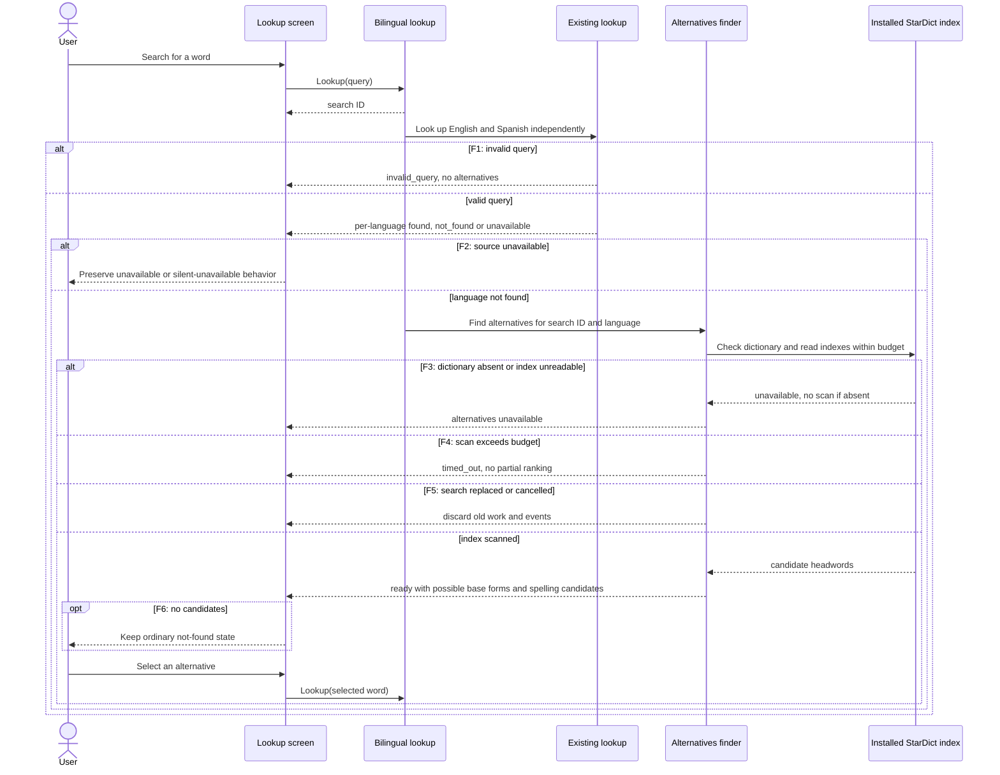
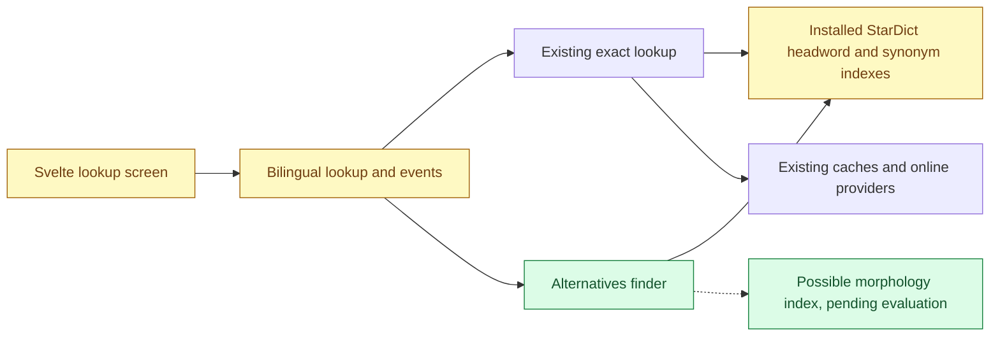

# Inflected forms and spelling suggestions — design

- **Wireframe:** [lookup alternatives](../../wireframes/lookup-alternatives.html)
- **Spec:** to be written after design approval
- **Design approved:** 2026-11-06 (`src:c34610a226566b0738a4`)

## Summary

When an English or Spanish lookup misses, offer possible base forms and spelling corrections as explicitly labelled alternatives. Selecting one starts a normal bilingual lookup. Exact results remain visible and are never silently replaced. This proposal uses installed offline dictionary indexes, without sending additional queries to an online service. Coverage is deliberately partial: a matching headword is not proof of a morphological relationship.

The current lookup checks offline, cache and online sources, and emits independent English and Spanish outcomes tagged with a search ID. Alternatives run separately so they cannot delay or change those outcomes. Existing dictionary downloads are optional; suggestions therefore require the relevant downloaded dictionary in this proposal.

## Main flow

English and Spanish results remain independent. A miss in one language may show alternatives alongside a found result in the other. The finder never asserts that an unavailable online source returned a miss. A new search or retry invalidates older alternatives for the affected search/language.

## Components

## Candidate approach and constraints

- Investigate a licensed form-to-lemma dataset for English and Spanish before choosing the morphology approach. UniMorph is a promising candidate, subject to coverage, distribution and performance validation. If a reliable suitable dataset cannot be established, use a bounded set of regular-form rules. Preserve ambiguous candidates and verify suggested base forms against the corresponding installed dictionary. Examples are illustrative, not coverage promises.
- Rank spelling candidates by bounded Unicode edit distance and deterministic tie-breaks, retaining original spelling and accents for display. Propose at most five per language. For a multiword query, search the installed dictionary’s phrase headwords separately for typo corrections, such as `look foward to` → `look forward to`. Offer only candidates present in that dictionary and require a click to search them (`src:23d2651f2c57ed43c790`). Bound phrase length and search work; exact limits, accent handling and ranking need evaluation against real data.
- Candidate generation must be bounded, cancellable and independent of exact lookups. Current index scanning is lazy and uses a mutex; feasibility, first-use latency and memory cost must be measured with both real dictionaries before choosing an index structure. A timeout produces no misleading partial top-N ranking. Precise budgets are for the spec decision.
- No automatic correction or lookup-time network request is proposed. A morphology dataset may require a separately packaged or downloaded derived index; its format, license and update/rollback behavior remain to be decided. Existing caches and dictionary files must remain compatible.

## Contract seam

Existing `Lookup(query)` and per-language outcomes remain intact. A proposed separate `lookup-alternatives` event carries `SearchID`, `Query`, `Language`, `Status` (`ready`, `unavailable`, `timed_out`), `BaseForms` and `Spelling`. Only the current search and language retry may update the screen. Empty arrays mean no suggestions; they do not establish that the word is invalid. The exact event names and limits will be settled in the spec.

| Screen state | Trigger and response |
|---|---|
| Searching | Existing lookup pending; no alternatives required yet |
| Found in one language, other pending | Existing independent result events |
| Language not found, suggestions loading | Existing `not_found`, then alternative scan begins |
| Possible base forms / spelling | `ready` with corresponding candidates; buttons start a new lookup |
| No alternatives | `ready` with empty lists; retain not-found message |
| Alternatives unavailable or timed out | `unavailable` or `timed_out`; retain exact result or miss and offer no unverified suggestions |
| Invalid / source unavailable | Existing result state; do not present a provider failure as a spelling error |
| Narrow window | Same states and controls wrap without horizontal overflow |

## Decisions and open questions

- Alternatives appear only when that language misses. Requiring the relevant offline dictionary is acceptable. Multiword spelling correction is in scope, using a separate search over dictionary phrase headwords. The user likes the wireframe (`src:6f16694188c7fc53cc4a`, `src:23d2651f2c57ed43c790`).
- Investigate a compatible English and/or Spanish morphology dataset first. If none proves reliable and suitable, use partial regular-form coverage. The dataset, distribution method, licensing obligations, performance and fallback remain open for review.
- How much additional download or disk usage is acceptable for a morphology index? A measured proposal will be needed before the spec.

Research: [English and Spanish morphology](../../reports/English%20and%20Spanish%20morphology.md). UniMorph is the recommended first candidate to evaluate, not an approved dataset.

## References and verification

- Existing behavior: `internal/core/lookup.go`, `internal/core/bilingual_service.go`, `internal/adapters/offline.go` and `frontend/src/routes/+page.svelte`.
- [MediaWiki Search API](https://www.mediawiki.org/wiki/API%3ASearch/en) exposes suggestion metadata, but its suitability, language filtering and extra network behavior are not established for this proposal.
- Offline index performance, candidate quality, dictionary coverage and licensing implications of any new dataset remain unverified.
