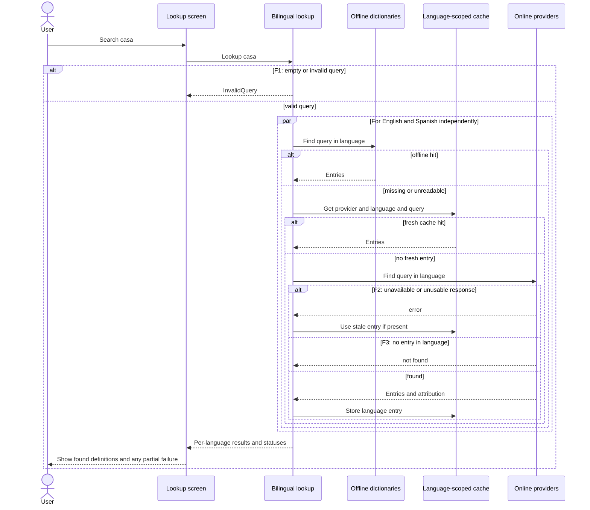
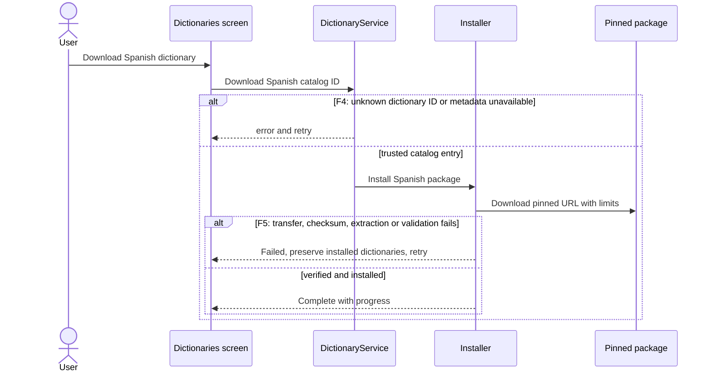
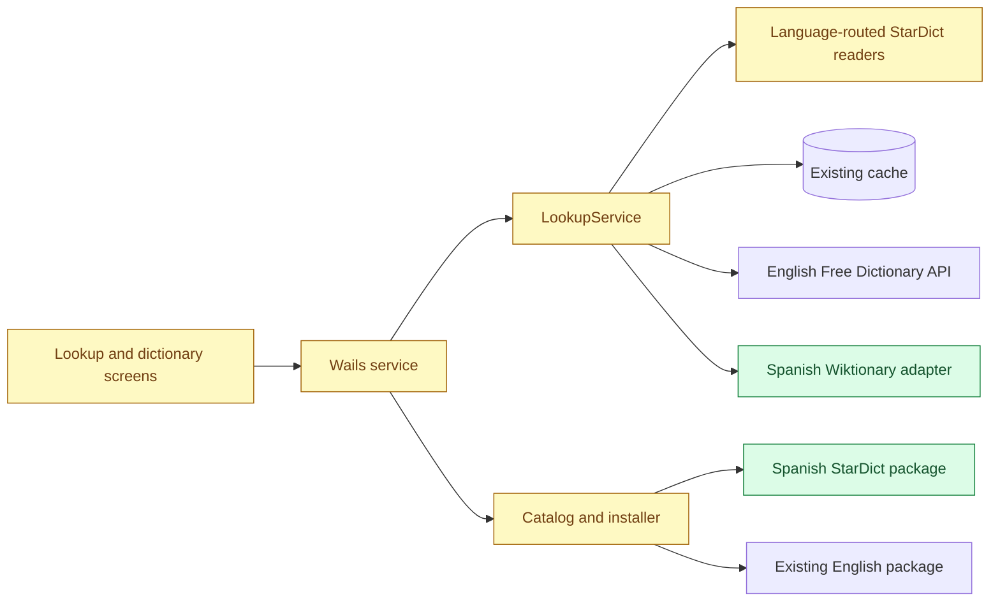

# Spanish lookup — system design

- **Wireframe:** [Spanish lookup and dictionaries](../../wireframes/spanish-support.html)
- **Design approved:** 2026-10-29 in chat (`src:58170218c984fa66a08b`).
- **Spec:** to be written after confirming the [proposed decisions](DECISIONS.md).

## Summary

Search English and Spanish automatically for every query, without a language selector. Show available definitions grouped and labelled by language, including both when a word exists in both. Each language independently follows offline dictionary, fresh cache, online provider and stale fallback, so a hit in one language does not prevent looking up the other. English keeps its current sources; Spanish uses the Spanish Wiktionary edition online and a separately downloaded Spanish–Spanish Wiktionary StarDict snapshot offline. The interface remains in English.

The [publisher's catalog](https://xxyzz.github.io/wiktionary_stardict/) lists a Spanish edition with approximately 124,000 Spanish entries and a 23 MB download (catalog snapshot can change). Pin a specific release, exact size and publisher checksum after verifying the package and its license metadata. [MediaWiki's parse API](https://www.mediawiki.org/wiki/API:Parsing_wikitext) supplies rendered page HTML; the Spanish adapter must extract only Spanish definitions and reject ambiguous or unparseable content rather than presenting other-language text as a definition. Confirm real samples and coverage before finalizing its extraction contract.

## Main flow

## Components

## Data and compatibility

No database migration. Keep the existing English `20261018/en-en.ifo` layout and cache keys readable. Install Spanish into a separate identity-specific directory so installation, recovery and replacement cannot overwrite English. Catalog records carry language, source, package identity, size and checksum; only catalog IDs can trigger downloads. Use independent readers and caches per language. The existing cache key already includes provider and language; select a distinct Spanish provider ID without invalidating English cache entries. A failed install leaves any previously working dictionary intact. Existing English-only settings and data require no deletion. No language selection or setting is needed.

## Contracts and screen states

The frontend starts `Lookup(query)` and receives independently delivered outcomes per language, each with a search ID, query, status, entries, origin and stale flag. The framework-independent `BilingualLookup` contract uses callbacks and a `SourceResolver` for language-specific source and provider identity; the Wails transport will relay those outcomes. The core callback shape makes the incremental delivery requirement explicit. Both searches run concurrently and each uses the existing per-language offline-first order. Results appear as they arrive, grouped English then Spanish when present; slow or failed providers do not hide successful results. If one language fails, show its unavailable message alongside the other language's definitions, with retry. Show “No definitions found” only when both report not found; show unavailable if neither found and at least one failed. If a stale entry is used, label it within its language group. A new search invalidates or cancels all earlier in-flight work.

`Dictionaries()` returns both catalog entries; `Download(id)` remains restricted to the catalog. Progress identifies the selected dictionary and download failure can be retried. The search, bilingual and partial results, offline notice, loading, missing, error, stale, install progress and install failure states are shown in the wireframe. Each result and dictionary entry links to its actual source and license, and README attribution identifies the publisher and modifications. Treat downloaded HTML as untrusted: extract plain text, never render provider markup, bound response size and time, and escape titles in URLs. Preserve the existing download verification and archive protections.

## Open questions and verification before specification

- The Spanish online adapter's extraction needs representative live samples across meanings, accents, multiple language sections, redirects and missing pages. Check Spanish Wiktionary's content reuse terms and the exact pinned package's license and checksum before locking the contract. HTML layouts may change; parsing failures must surface as unavailable rather than false definitions.
