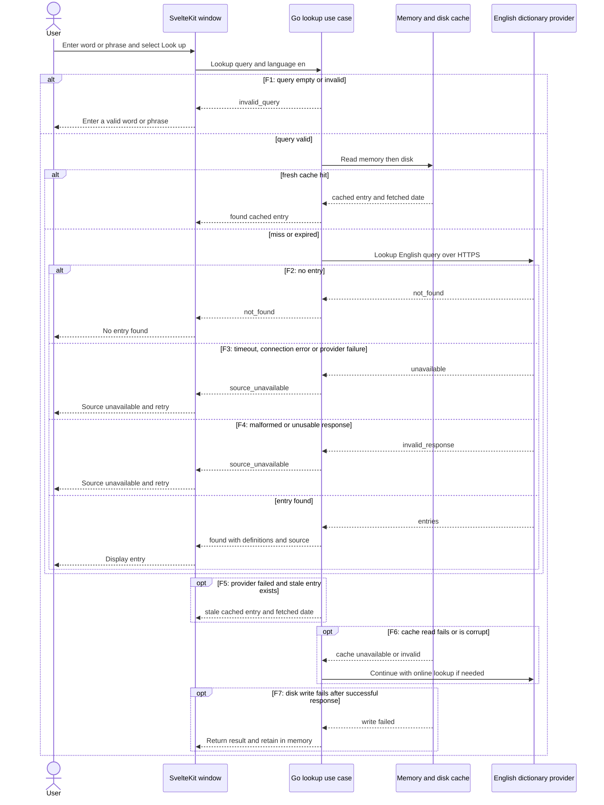
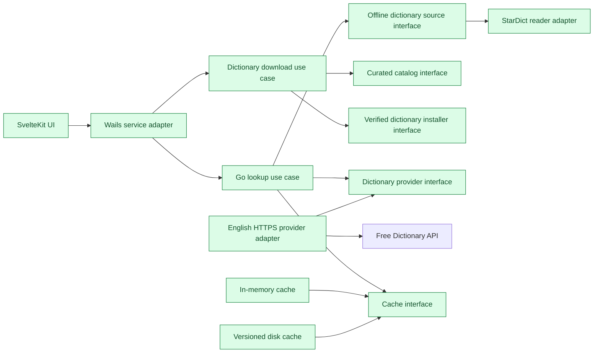
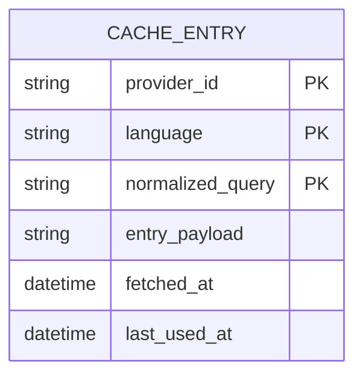

# Word lookup — system design

- **Wireframe:** [word-lookup.html](../../wireframes/word-lookup.html)
- **Initial design approved:** 2026-10-26, with later changes in chat
- **Design decisions:** agreed 2026-10-27; revised flows below are for spec review
- **Spec:** [SPEC.md](../../specs/word-lookup/SPEC.md)

## Summary

A Linux-first Wails desktop app uses a SvelteKit frontend and Go services to look up English words and phrases online. User action enables online lookup, making query transmission explicit. Definitions, part of speech and source attribution appear in a compact window. A two-level cache avoids repeat network requests and serves prior entries offline. An in-app downloadable offline dictionary is required in v1; Spanish is desirable but not required; inflections and suggestions are deferred. A provider boundary keeps those additions possible without requiring them now.

## Main flow

A newer search supersedes an older response. The UI stays responsive while network work runs. The provider is documented at [Free Dictionary API](https://github.com/meetDeveloper/freeDictionaryAPI); its source and terms, phrase coverage and operational reliability must be verified before release.

## Components

The frontend holds presentation state, the use case validates and coordinates, and an adapter translates the external response into domain entries. Go owns network access; the frontend renders definition text as text. SvelteKit static output is embedded/served by Wails and does not require a Node server in production. Exact routes and static adapter integration are implementation details to verify after approval. The use case coordinates memory, disk and the provider through interfaces. An offline source adapter can use the pure-Go go-stardict reader. A separate download manager installs curated, verified dictionaries on user action; lookup checks an installed local source before the cache and online provider. The core lookup remains usable without an installed dictionary.

## Contracts

`Lookup(query, language)` returns `found(entries)`, `invalid_query` (F1), `not_found` (F2), or `source_unavailable` (F3/F4). The first release accepts `en` only. Example entry: `{headword: "hello", language: "en", meanings: [{part_of_speech: "noun", definitions: ["A greeting."]}], source_url: "https://en.wiktionary.org/wiki/hello"}`; wording is illustrative. Source URL and applicable attribution come from the provider response, not a fabricated attribution.

The adapter sends `GET https://api.dictionaryapi.dev/api/v2/entries/en/{encoded-query}`. The provider documents its v2 response as an array with `word`, `meanings`, `partOfSpeech`, and `definitions[].definition`; HTTP 404 maps to not found, 2xx valid entries to found, all other statuses and transport errors to unavailable. Invalid or absent required response fields map to unavailable. Lookups may update a versioned local cache, but do not modify source dictionary data. There is no app-owned HTTP API. Cache policy and limits are specified in the linked spec.

## Data model

Disk records include a schema version and may be discarded and rebuilt. There is no prior app data to migrate. Writes are atomic or transactional. The cache is distinct from a full offline dictionary.

## Contract seam

| State | Trigger or outcome |
|---|---|
| Ready | App open; user sees online lookup notice |
| Searching | Valid request pending |
| Result | `found` with definition, source and cache date when cached |
| Stale result | Provider fails with an expired entry available (F5) |
| Cache read or write failure | Continue lookup or show successful result (F6/F7) |
| Invalid | `invalid_query` (F1) |
| No entry | `not_found` (F2) |
| Source unavailable | `source_unavailable` (F3/F4), retry available |

## Open questions

- Validate provider's current terms and attribution, and real phrase coverage before release. If it cannot meet requirements, revisit the source and spec.
- Measure latency and verify the Wails/SvelteKit packaged build on the target Linux environment.

## Offline dictionary flow

The user selects Download for a curated dictionary in the app. The Go download manager fetches and verifies the package into temporary storage, validates its files, and atomically installs it in the application data directory. Progress and failures are visible and lookup remains available. Installed files survive restart. A local hit returns its definition and attribution; absence, read failure, or a miss continues to memory cache, disk cache and the online provider. The dataset, attribution, sizes, UI treatment and update mechanism require validation before shipping. The download feature's detailed safety and acceptance requirements are in the spec.
